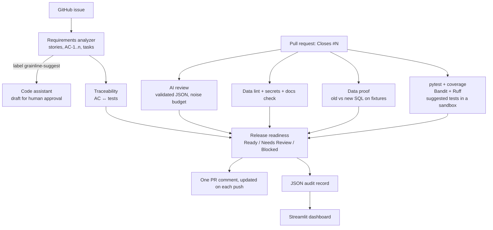

# 🌾 Grainline

**An AI-assisted software development lifecycle for data pipelines.** Grainline connects requirements → review → data proof → tests → release readiness inside GitHub, and it is built around one rule:

> **Only tools and data can block a release. The AI explains, suggests, and drafts; it never decides alone.**

Generic AI reviewers mostly read the diff and comment, which makes them noisy, and they miss data bugs such as join fan-out, NULL traps, and dropped rows. Grainline adds deterministic data checks and a **data proof**: it runs the old and new version of a changed SQL model on fixture data and compares the outputs, so a finding about data correctness comes with evidence.

## What it does

| Stage | Feature | How |
|---|---|---|
| Requirements | **Requirements analyzer** | A GitHub issue becomes user stories, Given/When/Then acceptance criteria (AC-1, AC-2, ...), tasks, open questions, and test ideas, posted as a comment |
| Development | **Code assistant (human-approved)** | Label an issue `grainline-suggest` to get a draft implementation and tests posted for review. Nothing is committed automatically; paths are sanitized |
| Review | **AI PR reviewer** | Structured, validated findings (file, line, severity, category, suggestion) with a **noise budget** of 5 per PR and no style nitpicks |
| Review | **Data lint** | Deterministic SQL and pandas rules: LEFT JOIN turned into INNER JOIN by a WHERE filter, COUNT(*) after a join, NOT IN with NULLs, unguarded division, merge without `validate=`, and more |
| Review | **Data proof** | Old vs new SQL on fixture CSVs: row counts, duplicate grain keys (fan-out), removed columns, NULL-rate jumps, and changed values with examples |
| Security | **Security and quality** | Secret detection on added lines, SQL-injection and mutable-default rules, Bandit, Ruff, and a docstring check for new public functions |
| Testing | **Testing assistant** | Runs pytest with coverage, runs the AI's suggested tests in a throwaway sandbox file, and explains failing tests in plain language |
| Traceability | **Requirement-to-test mapping** | A PR that says `Closes #N` is checked against that issue's acceptance criteria; tests named `test_ac_1_...` count as coverage |
| Release | **Release readiness** | Deterministic score out of 100 and a verdict: **Ready**, **Needs Review**, or **Blocked**, with blockers listed |
| Reporting | **Audit history and dashboard** | Every run saves a JSON record; the Streamlit app shows verdicts, scores, findings by source, coverage, and time since a PR was opened |
| Docs | **Documentation** | A changelog line per PR, and flags for new public functions without docstrings |

## Architecture



## How the verdict is decided

| Evidence | Effect |
|---|---|
| Failing tests, a high-severity Bandit issue, a detected secret, or a data-proof block (new duplicate keys, removed columns, a query that no longer runs) | **Blocked** |
| AI findings, data-lint findings, changed values on fixtures, low coverage, or acceptance criteria without tests | Lower the score and can mark **Needs Review**, but never block on their own |
| Score of 80 or more with no blockers or open review items | **Ready** |

Thresholds are set in `grainline.toml`. Set the repository variable `GRAINLINE_FAIL_ON_BLOCK=1` to fail the check when the verdict is Blocked.

## Try it in the browser

```bash
pip install -r requirements.txt
export GROQ_API_KEY="your-key"          # optional; without it only the deterministic checks run
streamlit run dashboard/app.py
```

| Tab | What you can do |
|---|---|
| Review code | Paste code or a diff, or load a planted-bug example, and see AI and deterministic findings side by side |
| Requirements | Turn a plain-English request into stories, acceptance criteria, and tasks |
| Data proof | Compare an old and new SQL model on the example fixtures (a correct and a fan-out version are preloaded) |
| Release history | Verdicts, scores, and findings from past PR runs |

Deploy on Streamlit Community Cloud with main file `dashboard/app.py` and `GROQ_API_KEY = "your-key"` in Secrets, or with Docker:

```bash
docker build -t grainline . && docker run -p 8501:8501 -e GROQ_API_KEY=your-key grainline
```

Each browser session is limited to 10 AI calls to protect the API key.

## Set it up on a repository

1. Add this project to a repository you own, including the hidden `.github/` folder.
2. Add the secret `GROQ_API_KEY` under **Settings → Secrets and variables → Actions**. `GITHUB_TOKEN` is provided automatically.
3. Point `grainline.toml` at your SQL models (`models_dir`) and fixture CSVs (`fixtures_dir`). Declare each model's output grain on its first line, for example `-- grain: seller_id`.
4. Open an issue: Grainline posts requirements. Add the `grainline-suggest` label for a draft implementation.
5. Open a pull request that says `Closes #<issue>`: Grainline posts one review comment and updates it on every push.
6. Download the `grainline-records-*` artifacts into `reports/` to populate the dashboard.

## Benchmark

`eval/benchmark.py` contains 9 planted bugs (code, data, and security) and 2 clean changes, and compares an LLM-only reviewer with Grainline (LLM + deterministic checks).

```bash
python -m eval.benchmark --offline     # deterministic layer only
GROQ_API_KEY=... python -m eval.benchmark
```

| Configuration | Planted bugs caught | False alarms on clean changes |
|---|---|---|
| Deterministic checks only (offline) | 7 / 9 | 0 / 2 |
| LLM only | _fill in after running_ | _fill in_ |
| Grainline (LLM + deterministic) | _fill in after running_ | _fill in_ |

The deterministic rules were written alongside these cases, so treat the offline number as a sanity check rather than a fair score. A stronger evaluation adds bugs written by someone else and real pull requests.

## Project layout

| Path | Purpose |
|---|---|
| `grainline/pipeline.py` | The connected PR workflow, free of GitHub calls so it can be tested |
| `grainline/cli.py` | GitHub Actions entry points: `pr` and `issue` |
| `grainline/review.py` | AI review prompt and noise budget |
| `grainline/requirements_ai.py` | Requirements analyzer, comment rendering, and the hidden JSON used for traceability |
| `grainline/codegen.py` | Human-approved draft implementations |
| `grainline/data_lint.py` | Deterministic SQL, pandas, and Python rules |
| `grainline/data_proof.py` | Old vs new SQL on fixture data (SQLite) |
| `grainline/security.py`, `docs_check.py` | Secret detection and docstring checks |
| `grainline/checks.py`, `testgen.py` | pytest with coverage, Bandit, Ruff, sandboxed suggested tests, failure explanations |
| `grainline/traceability.py`, `readiness.py` | AC-to-test mapping and the release verdict |
| `grainline/schemas.py`, `llm.py`, `http.py` | Validated LLM outputs, JSON-only calls, retries with backoff |
| `dashboard/app.py` | Streamlit app |
| `eval/benchmark.py` | Planted-bug benchmark |
| `examples/` | Example SQL models (correct and fan-out versions) and fixture CSVs |
| `tests/` | 20 unit tests |

## Design decisions

- **Evidence before opinion.** Blocking requires a tool result or a data proof. AI findings are labeled with their source, so reviewers know what is proven and what is suggested.
- **Low noise.** At most 5 AI findings per PR, ranked by severity, with style left to Ruff.
- **Validated outputs.** Every LLM response is parsed as JSON and checked field by field; malformed findings are dropped, and IDs like AC-1 are renumbered so references stay consistent.
- **Failure handling.** HTTP calls retry with backoff; if the AI is unavailable, the deterministic checks still run and post.
- **Human in the loop.** Generated code is posted for review and never committed; generated tests run only in a temporary file.
- **Safe CI.** The workflows use `pull_request`, not `pull_request_target`, so code from forks never runs with secrets.

## Limitations

- The data proof runs SQL on SQLite; warehouse-specific syntax (for example BigQuery or Snowflake functions) needs a compatible fixture engine such as DuckDB.
- The reviewer sees the diff and the linked requirements, not the whole codebase.
- The benchmark is small and partly written alongside the rules.

## Roadmap

- DuckDB engine for warehouse-style SQL.
- Go file support.
- Inline review comments on specific lines.
- A larger benchmark from real pull requests.

## AI use

Starter code was drafted with AI assistance (Claude), then reviewed, tested, and extended by the author.
