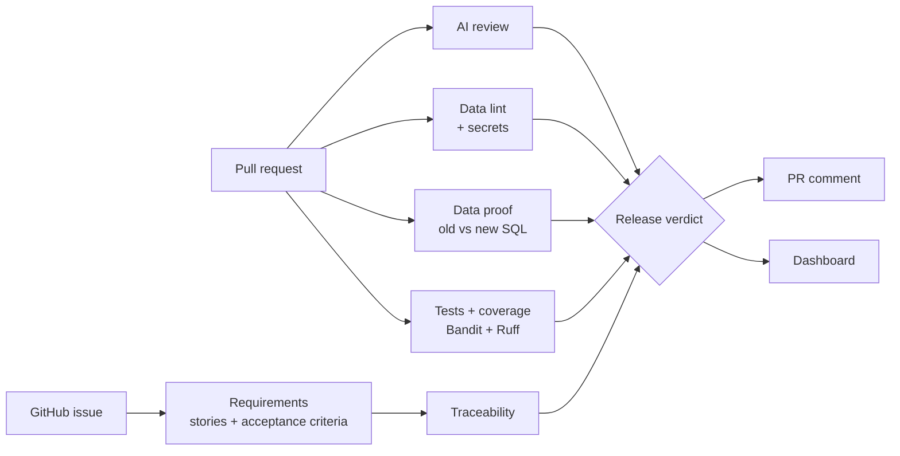

<div align="center">

# 🌾 Grainline

### Catch the data bugs that generic AI code reviewers miss, with proof.

AI-assisted software delivery for data pipelines: from GitHub issue to release verdict.

**[Live demo](https://grainline-ai.streamlit.app)** · **[How it works](#how-it-works)** · **[Quick start](#quick-start)** · **[Benchmark](#benchmark)**


</div>

---

## Why Grainline

AI code reviewers are good at reading a diff and commenting. They are much weaker at the bugs that matter most in data work, because those bugs live in the **data**, not in the syntax:

- a join that quietly **double-counts** rows,
- a `WHERE` clause that turns a `LEFT JOIN` into an **inner join** and drops records,
- a `NOT IN` that returns **nothing** when a NULL appears.

The query runs, the numbers look believable, and the report is wrong.

Grainline closes that gap. When a pull request changes a SQL model, it **runs the old and the new version on fixture data and compares the results.** If revenue doubles or a customer disappears, the PR comment shows exactly which rows changed. Around that core, it connects the rest of the delivery workflow: requirements, review, tests, and a release verdict.

> **Design rule:** only tools and data can block a release. The AI explains, suggests, and drafts; it never decides on its own.

## See it catch a real bug

A pull request "simplifies" a net-sales model by joining refunds directly instead of aggregating them first. It looks harmless. Grainline runs both versions on the fixtures:

| seller | before (correct) | after (the PR) |
|---|---|---|
| A | 12,000 | **17,000** |
| B | 8,000 | **missing** |
| C | 0 | 0 |

And reports why:

| Severity | Finding | Source |
|---|---|---|
| 🔴 high | `WHERE` filters on the LEFT JOINed table `r`, which drops unmatched rows | data lint |
| 🟠 medium | `COUNT(*)` after a join counts duplicated rows if the join fans out | data lint |
| 🟠 medium | Row count changed on fixtures: 3 → 2 | data proof |
| 🟠 medium | `net_cents` for seller A changed: 12,000 → 17,000 | data proof |

Order 101 has two refunds, so it was counted twice; seller B had no refund, so the `WHERE` clause removed it. You can run this exact example in the **[live demo](https://grainline-ai.streamlit.app)** with one click, no setup needed.

## How it works



1. **Requirements.** Open an issue in plain English. Grainline replies with user stories, numbered Given/When/Then acceptance criteria, tasks, and open questions.
2. **Review.** On every pull request, an LLM returns structured findings (capped at 5, most severe first), alongside deterministic rules for SQL, pandas, and secrets.
3. **Data proof.** Changed SQL models are run before and after on fixture CSVs to check duplicate keys, dropped rows, removed columns, NULL rates, and changed values.
4. **Tests.** pytest runs with coverage, suggested tests run in a throwaway sandbox, and failing tests are explained in plain language. Tests named after acceptance criteria (`test_ac_1_...`) are traced back to the issue.
5. **Release.** Everything rolls up into a score out of 100 and one verdict: **Ready**, **Needs Review**, or **Blocked**.

One comment on the PR holds it all and updates on every push. Each run is also saved as a JSON record for the dashboard.

## What blocks a release

| Evidence | Result |
|---|---|
| Failing tests, a high-severity Bandit issue, a committed secret, personal data such as a card or Social Security number, or a data proof showing new duplicate keys, removed columns, or a broken query | ⛔ **Blocked** |
| AI findings, data-lint warnings, suspicious code, phishing-style links, other privacy warnings, changed values on fixtures, low coverage, or acceptance criteria without tests | 🟠 **Needs Review** |
| Score of 80 or more, with nothing open | ✅ **Ready** |

Thresholds live in `grainline.toml`. Set the repository variable `GRAINLINE_FAIL_ON_BLOCK=1` to make the GitHub check fail when a PR is blocked.

## Features

- **Requirements analyzer:** issues become stories, acceptance criteria, tasks, and test ideas.
- **Code assistant:** label an issue `grainline-suggest` to get a draft implementation, posted for review and never committed.
- **AI review:** validated JSON findings with severity, category, line, and a fix; a noise budget keeps comments focused.
- **Data lint:** LEFT JOIN filtered in WHERE, COUNT(*) after a join, NOT IN with NULLs, unguarded division, pandas merge without `validate=`, deduplication without a key.
- **Data proof:** before-and-after SQL on fixture data, with examples of every changed value.
- **Security and quality:** secret detection, SQL-injection and mutable-default rules, Bandit, Ruff, gofmt for Go files, and docstring checks.
- **Languages:** reviews Python, SQL, and Go changes; security and privacy scans run on every changed text file, including docs, data, and workflows.
- **Suspicious-code scan:** flags malware-style patterns such as executing decoded payloads, download-and-run scripts, reverse-shell signs, crypto miners, unsafe deserialization, and risky GitHub Actions settings. These are heuristics for a human to check, not an antivirus.
- **Phishing-link scan:** flags brand look-alike domains, punycode domains, link shorteners, raw-IP links, `@` tricks, risky top-level domains, and login pages over plain http in any changed file, including docs.
- **Privacy scan:** flags payment card numbers (Luhn-checked), Social Security numbers, personal emails and phone numbers in committed data, personal fields written to logs, and queries that expose personal-data columns.
- **Testing assistant:** coverage, sandboxed suggested tests, and plain-language failure explanations.
- **Traceability:** every acceptance criterion mapped to the tests that cover it.
- **Release readiness:** a deterministic score and verdict.
- **Dashboard:** try the reviewer, analyze requirements, run a data proof, and track verdicts over time.

## Quick start

**Run the app locally**

```bash
git clone https://github.com/adityakusetti/grainline.git
cd grainline
pip install -r requirements.txt
streamlit run dashboard/app.py
```

The Overview and Data proof tabs work without any API key. To enable the AI features, set `GROQ_API_KEY`:

```bash
export GROQ_API_KEY="your-key"
```

**Or with Docker**

```bash
docker build -t grainline .
docker run -p 8501:8501 -e GROQ_API_KEY=your-key grainline
```

**Try it on any public pull request**

Open the **[live demo](https://grainline-ai.streamlit.app)**, go to **Review a GitHub PR**, and paste a link such as `https://github.com/owner/repo/pull/123`. Grainline fetches the diff and runs the AI review, data lint, and secret checks in the browser.

**Add it to your own repository (one file)**

1. Add your Groq key as a repository secret named `GROQ_API_KEY` (**Settings → Secrets and variables → Actions**).
2. Create `.github/workflows/grainline.yml`:

```yaml
name: Grainline
on:
  pull_request:
    types: [opened, synchronize, reopened]
permissions:
  contents: read
  pull-requests: write
  issues: write
jobs:
  review:
    runs-on: ubuntu-latest
    steps:
      - uses: actions/checkout@v4
      - uses: adityakusetti/grainline@main
        with:
          groq-api-key: ${{ secrets.GROQ_API_KEY }}
          models-dir: models        # your SQL models
          fixtures-dir: fixtures    # small CSV samples, one table per file
```

3. Start each SQL model with its output grain, for example `-- grain: seller_id`, so Grainline can detect duplicate keys.
4. Open a pull request. Grainline posts one comment and updates it on every push.

For the full workflow, including requirements from issues and draft implementations, copy this repository's `.github/workflows/` folder as well.

## Benchmark

`eval/benchmark.py` plants 12 bugs (logic, data, security, and privacy) and includes 3 clean changes, then compares an LLM-only reviewer with Grainline.

```bash
python -m eval.benchmark --offline        # deterministic checks only
GROQ_API_KEY=... python -m eval.benchmark # adds the LLM comparison
```

| Configuration | Planted bugs caught | Detection rate | False alarms on clean changes | False-positive rate |
|---|---|---|---|---|
| Deterministic checks only | 30 / 36 | 83% | 0 / 9 | 0% |
| LLM only | 27 / 36 | 75% | 3 / 9 | 33% |
| **Grainline (LLM + deterministic)** | **34 / 36** | **94%** | 3 / 9 | 33% |

Run with `openai/gpt-oss-120b` over 3 runs of 12 planted bugs and 3 clean changes; counts are summed across runs. Reproduce it from the **Actions** tab with the *Grainline benchmark* workflow.

**What this shows:** combining the two layers catches more bugs than either alone (94% vs 75% for the LLM alone). Every false alarm came from the LLM, and because AI findings can only mark a change *Needs Review*, never *Blocked*, none of them would have blocked a release. That is the reason for Grainline's design rule.

The deterministic rules were developed alongside these cases, so the offline result is a sanity check rather than a final score. The next step is a larger benchmark drawn from real pull requests.

## Tech stack

| Area | Tools |
|---|---|
| Core | Python 3.11 |
| AI | Groq API, JSON-only responses, field-by-field validation |
| GitHub | REST API, GitHub Actions |
| Quality | pytest, pytest-cov, Bandit, Ruff |
| Data proof | SQLite, fixture CSVs |
| App | Streamlit, pandas, Docker |

## Project structure

```
grainline/
├── grainline/          core package
│   ├── pipeline.py     the connected PR workflow
│   ├── cli.py          GitHub Actions entry points (pr, issue)
│   ├── review.py       AI review and noise budget
│   ├── data_lint.py    SQL, pandas, and Python rules
│   ├── data_proof.py   old vs new SQL on fixture data
│   ├── threats.py      suspicious code, phishing links, privacy
│   ├── readiness.py    score and verdict
│   └── ...             requirements, codegen, security, tests, traceability
├── dashboard/app.py    Streamlit app
├── eval/benchmark.py   planted-bug benchmark
├── examples/           sample SQL models and fixture data
├── tests/              unit tests
├── action.yml          reusable GitHub Action
└── .github/workflows/  PR, issue, and benchmark workflows
```

## Engineering choices

- **Evidence before opinion.** Every finding is labeled with its source, so reviewers can tell what was proven from what was suggested.
- **Fail safe.** API calls retry with backoff; if the AI is unavailable, every deterministic check still runs and posts.
- **Validated AI output.** Responses are parsed as JSON and checked field by field. Anything malformed is dropped, and IDs like AC-1 are renumbered to stay consistent.
- **Human in the loop.** Generated code and tests are suggestions. Nothing is committed automatically.
- **Safe CI.** Workflows run on `pull_request`, so code from forks never sees repository secrets.

## Roadmap

- [ ] DuckDB engine, for warehouse-style SQL such as BigQuery and Snowflake
- [ ] Inline comments on the exact changed lines
- [ ] Go support
- [ ] A larger benchmark built from real pull requests

## Limitations

- The data proof uses SQLite, so some warehouse-specific SQL needs the planned DuckDB engine.
- The reviewer sees the diff and the linked requirements, not the entire codebase.

## Author

**Aditya Sai Kumar Kusetti** · M.S. Data Analytics Engineering, Northeastern University
[LinkedIn](https://www.linkedin.com/in/kusetti-aditya) · [Portfolio](https://kusettiaditya.me)
